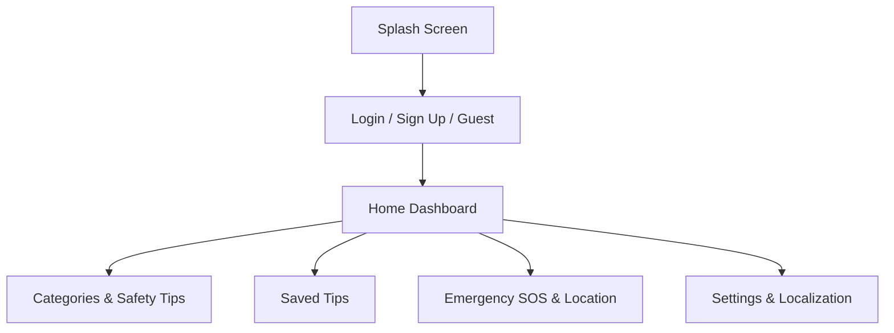

<div align="center">

  

  # Metrixa
  ### **Safety • Support • Hope**

  *A modern personal safety companion and support application designed to empower individuals—especially GBV victims and vulnerable groups—with reliable safety tips, emergency tools, and live location sharing.*

  [](https://flutter.dev)
  [](https://dart.dev)
  [](https://m3.material.io)
  [](https://opensource.org/licenses/MIT)

</div>

---

## 🌟 Overview

**Metrixa** is a compassionate, privacy-focused mobile application built with **Flutter**. It equips users with essential safety resources, emergency contacts, subscription-based safety alerts, multi-language support (English, Zulu, and Xhosa), and secure live GPS location sharing in critical situations.

---

## ✨ Key Features

-  **Secure Account Creation & Login**:
  - Sign up with your email and password.
  - Persistent login session management powered by `SharedPreferences`.
  - Quick **"Continue as Guest"** mode for immediate access without registration.
-  **Safety Categories & Tips**:
  - Curated safety advice across Home Safety, Dating Safety, Transport, Night Out, Personal Safety, Emergency Preparedness, and Online Safety.
  - Save your favorite tips for offline / quick reference.
-  **Custom Subscriptions & Alerts**:
  - Subscribe to specific safety categories with notification toggles and daily safety tips.
-  **Emergency SOS & Live Location Sharing**:
  - Instant quick-dialing for emergency rescue services.
  - Add and manage personal emergency contacts.
  - One-tap emergency sharing containing a Google Maps link with your exact real-time GPS coordinates.
-  **Multi-Language Support**:
  - Full localization support for English, Zulu, and Xhosa.

---

## 📱 App Screenshots / Flow



---

## Tech Stack & Dependencies

- **Framework**: [Flutter](https://flutter.dev) (Dart)
- **Design System**: Material 3 with custom theming
- **State & Storage**: `shared_preferences` for local persistence & authentication
- **Location Services**: `geolocator` for precise GPS coordinate retrieval
- **Sharing & Utilities**: `share_plus` for native sharing of emergency messages & Google Maps locations

---

##  Getting Started

### Prerequisites
- [Flutter SDK](https://docs.flutter.dev/get-started/install) (v3.12 or higher)
- Android SDK / Xcode (for iOS) or an active emulator/device.

### Installation

1. **Clone the repository**:
   ```bash
   git clone https://github.com/your-username/metrixa.git
   cd Metrixa
   ```

2. **Install dependencies**:
   ```bash
   flutter pub get
   ```

3. **Run tests**:
   ```bash
   flutter test
   ```

4. **Run the application**:
   ```bash
   flutter run
   ```

---

## Project Structure

```tree
lib/
├── app_state.dart          # Global state management & SharedPreferences persistence
├── categories_page.dart    # Safety categories & educational tips
├── category_detail_page.dart # Detailed view for category items
├── data.dart               # Static mock data, safety tips & translations
├── emergency_page.dart     # Emergency contacts & SOS location sharing
├── home_page.dart          # Dashboard & daily safety spotlight
├── location_share.dart     # GPS geolocator & Google Maps link generation
├── login_page.dart         # Authentication, account creation & guest mode
├── main.dart               # App entry point, splash screen & navigation shell
├── saved_page.dart         # Bookmarked/saved safety tips
├── settings_page.dart      # Account management, language & notifications
├── strings.dart            # Multi-language dictionary (English, Zulu, Xhosa)
└── tip_card.dart           # Reusable tip card component
```

---


WTC-A65ZZDUH